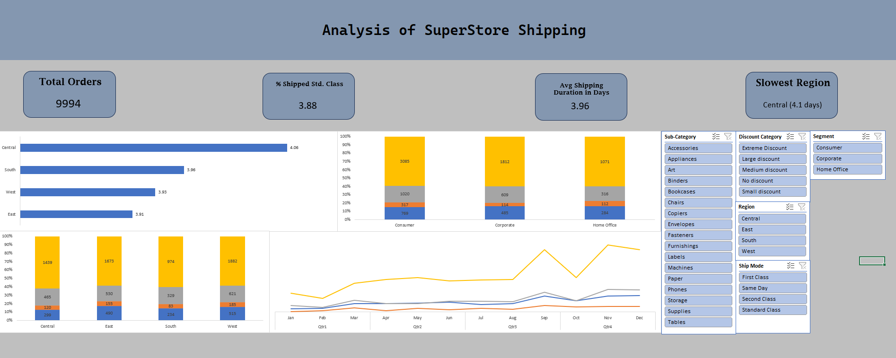

# Superstore Shipping & Delivery Analysis

An Excel dashboard built around one operational question instead of generic sales KPIs: how does shipping method vary by customer segment and region, and where are delays concentrated?

## Business Question
How does ship mode vary by segment and region, and which region has the slowest delivery?

## Key Metrics
| KPI | Value |
|---|---|
| Total Orders | 9,994 |
| Average Shipping Duration | 3.96 days |
| Slowest Region | Central (about 4.1 days) |

## What the Dashboard Shows
- **Average shipping duration by region** (Central, South, West, East)
- **Ship mode mix by customer segment** (Consumer, Corporate, Home Office) as 100% stacked bars
- **Ship mode mix by region**
- **Shipping trend across the year**, by month and quarter
- **Slicers** for sub-category, discount category, segment, region, and ship mode

## Observations
- Central is the slowest region at about 4.1 days, while the other three regions sit between 3.91 and 3.96 days.
- Standard Class is the dominant ship mode in every segment and every region.
- The gap between regions is small (a fraction of a day), so the Central delay is worth monitoring rather than alarming.

## Tools
Excel (Power Query, pivot tables, pivot charts, slicers)

## Dataset
Sample Superstore dataset. [Add the source link here]
